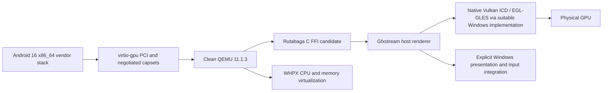

# GPU backend comparison

Evidence reviewed 2026-11-04. **No hardware-accelerated graphics backend was run by this mission.** Documentation and source inspection establish candidate interfaces, not an end-to-end Windows product. `versions.lock.json` pins the QEMU release and research revisions. The QEMU master manual identifies itself as 11.1.50, so release decisions below also use the checked-out 11.1.3 code.

| Component/path | Documented role and guest integration | Windows assessment | Runtime evidence here | Position |
|---|---|---|---|---|
| **Gfxstream** | Serializes GLES/Vulkan; guest encoders plus compatible transport and host decoder. Android Cuttlefish packages concrete EGL/GLES, Vulkan and composer integrations. | Upstream README provides Windows CMake/ClangCL build and Windows test dependencies (`libEGL.dll`, `libGLESv2.dll`, `vulkan-1.dll`). This documents the renderer build, not upstream QEMU/WHPX device integration. | BLOCKED: no built Windows renderer/test binary or guest. | Preferred renderer candidate to investigate. |
| **Rutabaga + QEMU virtio-gpu** | Rutabaga is an interface/dispatcher to renderers, not itself a GPU driver. QEMU has rutabaga device models with blob memory and gfxstream Vulkan plus experimental Android GLES/composer capsets. | Rutabaga describes a cross-platform design and its FFI represents OS handles. QEMU's presence of a backend is not proof that Windows shared memory, handle ownership, fences and scanout work. The README's FFI build recipe is Linux-oriented. | BLOCKED. Our clean diagnostic build intentionally has no Rutabaga library. | Preferred transport adapter candidate, subject to Windows tests. |
| **VirGL / virglrenderer** | Guest Mesa/Gallium VirGL sends a GL-oriented intermediate representation; host virglrenderer executes it. Android additionally needs matching Mesa EGL/GLES and allocator/composer wiring. | The reviewed documentation describes the Linux path; native Windows QEMU 3D is unqualified. ANGLE or Mesa-on-D3D options require their own build and compatibility experiment. | BLOCKED. | Useful Linux comparison; not selected as a proven Windows solution. |
| **Venus** | Mesa Vulkan protocol/guest ICD; renderer hosted in virglrenderer. Requires virtio-gpu context/blob/host-visible features, Vulkan external-memory capabilities and compatible host/guest kernels. | Published requirements describe Linux and Android host drivers with FD/DMA-BUF interfaces; a Win32 HANDLE/WHPX path is not established by those requirements. | BLOCKED. | Linux Vulkan comparison, not a documented drop-in native Windows path. |
| **Native Windows APIs** | Vulkan vendor ICDs, WGL/OpenGL, and ANGLE translation onto supported Windows APIs can execute host rendering. Guest transport still has to supply their work and synchronize it. | Gfxstream documents native Windows dependencies. WHPX virtualizes CPUs/memory; it does not expose a physical GPU to Android by itself. | Inventory only: RTX 2060 and UHD 630 reported by Windows. No rendering or utilization trace. | Necessary host capabilities, not complete emulator backends. |
| **Legacy Express GPU** | Proprietary virtio ID/packet ABI, custom EGL/GLES decoder, shadow contexts, WGL and GLFW. | A Windows-specific legacy implementation exists, but no matching guest image or modern API validation exists. Its device ID 32 now collides with SCMI. | Modern transport syntax probes fail in 3/4 units; no graphics runtime. | Preserve as reference; NO-GO for an immediate wholesale port. |
| **SwiftShader / llvmpipe / Lavapipe / WARP** | Software rendering can provide a control path or aid debugging depending on the selected stack. | Software rendering may run even if a renderer API initializes successfully. | Not run. | Explicit software controls; never count as physical GPU evidence. |

## Recommended candidate, not an approved foundation

The first integration question is whether the pinned Windows QEMU, Rutabaga FFI and Gfxstream can establish a context, exchange host-visible blob resources, execute an Android GLES/Vulkan workload and present correct frames. Keep the VMM boundary narrow. Avoid importing legacy display/threading machinery until there is evidence it solves a demonstrated gap.

A successful standalone Gfxstream test narrows this question but does not answer it. The native test must cover ABI compatibility between the QEMU MinGW build and the renderer's ClangCL/MSVC build, DLL/CRT allocation ownership, Win32 handle lifetimes, memory cache semantics under WHPX, completion fences, resize and device/context loss. Do not assume Unix FD or DMA-BUF paths work on Windows. Keep cross-domain/Wayland features off unless explicitly needed and tested there.

QEMU 11.1.3's Rutabaga device explicitly blocks migration. Snapshot/restore of an accelerated VM is therefore not an initial feature promise. Software scanout/copy fallback may provide a correctness path while still being unsuitable for the performance target; trace the number and size of CPU readbacks rather than advertising zero-copy rendering.

### Promotion evidence

1. Native Windows build and the strict CPU diagnostic boot pass, with the intended accelerator and no fallback.
2. Pinned renderer host tests pass on a hardware ICD, with software drivers disabled/reported.
3. Actual QEMU device creation and capset negotiation pass on Windows. Device enumeration alone is insufficient.
4. The Android 16 vendor/kernel combination boots; EGL/GLES and Vulkan correctness workloads execute. Capture physical device identity plus host GPU execution correlated with guest submissions and a visible changing output.
5. Repeat with a deliberately selected software renderer as a control. Validate the instrument can distinguish it; FPS alone is insufficient proof.
6. Meet frame pacing, input latency and stability criteria, then resolve the license/linkage gate before approving a migration architecture.

If Rutabaga's Windows path fails, record the exact failing interface before considering a narrow adapter or separate renderer process. A process boundary is an architecture/security option, not an automatic licensing solution. Switching to an Android Emulator/QEMU fork would change the clean-upstream constraint and needs an explicit architecture decision; its working Windows renderer cannot be used as evidence for this candidate unchanged.

## Primary sources

- [QEMU 11.1.3 virtio-gpu documentation source](https://gitlab.com/qemu-project/qemu/-/blob/v11.1.3/docs/system/devices/virtio/virtio-gpu.rst), [release Rutabaga implementation](https://gitlab.com/qemu-project/qemu/-/blob/v11.1.3/hw/display/virtio-gpu-rutabaga.c), [release Meson device wiring](https://gitlab.com/qemu-project/qemu/-/blob/v11.1.3/hw/display/meson.build).
- [Pinned Gfxstream build and test README](https://github.com/google/gfxstream/blob/94240f814c0097a63027ae680ea4bec7b0cb25f7/README.md).
- [Pinned Rutabaga README](https://github.com/magma-gpu/rutabaga_gfx/blob/4f2bcaf71a6497583362ed664d9fe21cc5043049/README.md), [C FFI implementation](https://github.com/magma-gpu/rutabaga_gfx/blob/4f2bcaf71a6497583362ed664d9fe21cc5043049/ffi/src/lib.rs), [crate features](https://github.com/magma-gpu/rutabaga_gfx/blob/4f2bcaf71a6497583362ed664d9fe21cc5043049/Cargo.toml).
- [AOSP Cuttlefish GPU documentation](https://source.android.com/docs/devices/cuttlefish/gpu), [pinned guest graphics packages](https://android.googlesource.com/device/google/cuttlefish/+/4d368849922b04124e66b1aad48f93b3209f3c8d/shared/graphics/device_vendor.mk).
- [Mesa VirGL](https://docs.mesa3d.org/drivers/virgl.html), [Mesa Venus requirements](https://docs.mesa3d.org/drivers/venus.html).
- [Microsoft WHPX API scope](https://learn.microsoft.com/en-us/virtualization/api/hypervisor-platform/hypervisor-platform).
